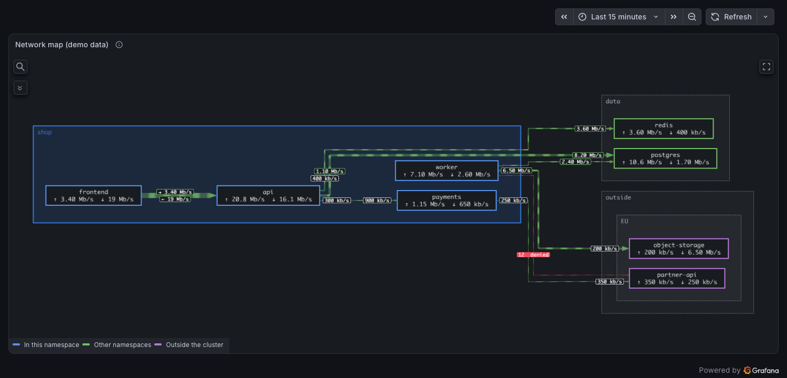

[//]: # ([![YOUTUBE]&#40;https://img.shields.io/youtube/channel/subscribers/UCxjo9tNt0ApLBpB46m49wvw&#41;]&#40;https://www.youtube.com/@mapgraf&#41;)
[](https://mapgl.org)
[](https://discord.gg/DZCAfzYwjC)
[](https://t.me/mapgrafana)
[✉️][email]

> **K8s Mapgl** (`k8s-mapgl-panel`) is a fork of [Mapgl](https://github.com/vaduga/mapgl) by Vadim Pyatakov (`vaduga-mapgl-panel`), changed for Kubernetes network maps since 2026-11-09: see [Network maps](https://github.com/eminaktas/mapgl/blob/main/docs/network-map-cards.md). GPL-3.0, like the original. Not in the Grafana catalog: install the release zip as an unsigned plugin.


Mapgl Panel plugin dev environment

### Network maps (this fork)

ELK layered layout across namespace boxes, nodes drawn as cards with template text, and labels
at both ends and the middle of routed lines: see [Network maps](docs/network-map-cards.md).



### Get started with provisioned dashboards

1. Install dependencies

   ```bash
   npm install
   ```

2. Build plugin in development mode and run in watch mode

   ```
   npm run dev
   ```

3. Build plugin in production mode

   ```bash
   npm run build
   ```

4. Spin up a Grafana instance and run the plugin inside it (using Docker)

   ```bash
   docker compose up --build
   ```

[email]: mailto:arbitr38@gmail.com
